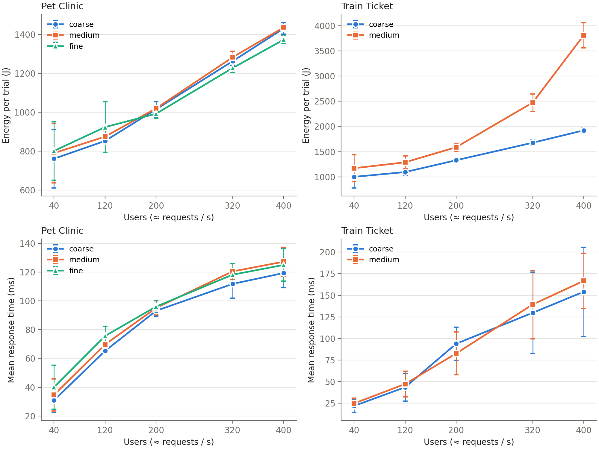

# Microservice Granularity vs. Energy and Performance: a Partial Replication

A partial replication, run on a single laptop, of:

> Y. Zhao, T. De Matteis, J. Bogner. *How Does Microservice Granularity Impact Energy Consumption and Performance? A Controlled Experiment.* arXiv:2502.00482, 2025. <https://arxiv.org/abs/2502.00482>

It is built on the authors' replication package. Their files are in `script_data/paper/`, with our fixes applied. Every change to their files is listed in [`CHANGES.md`](CHANGES.md).

## Key results

| Research question | Original study | This replication |
| --- | --- | --- |
| **RQ1 Energy, Pet Clinic** | Fine/medium use slightly more energy than coarse (small effects, +2–4 %) | **Not reproduced**: no difference (all Holm p = 1, negligible effects) |
| **RQ1 Energy, Train Ticket** | Medium > coarse, +27 %, Cliff's d = 0.40 (medium) | **Reproduced**: medium > coarse, +47 %, d = 0.35 (medium), Holm p = 0.003 |
| **RQ3 Load × granularity** | Medium Train Ticket "anomaly" at 320/400 req/s | Strong interaction (F = 111, p = 6e-34): medium costs +796 J at 320 users and +1888 J at 400 users, and nothing significant at ≤ 200 users |
| **RQ2 Response time** | Significant but negligible (Pet Clinic) or small (Train Ticket) | Significant but negligible for both systems |

- **Methodological note:** the original study removes outliers with an IQR filter applied across all load levels. On our data, that filter removes exactly the 10 Train Ticket medium trials at 400 users, which are the trials that carry the effect. The difference then becomes non-significant (p = 0.13).
- Full numbers are in `analysis/results*.txt`. The main figure is `analysis/fig_by_load.png`.



## What differs from the original study

| | Original | This replication |
| --- | --- | --- |
| Hardware | Server (Xeon Silver 4208) + separate PC for Locust | One laptop (Intel Core i5-13420H, 16 GB RAM), Windows + WSL2 + Docker Desktop |
| Load generator | Separate machine | Same laptop; Locust pinned to cores 0–1, containers pinned to cores 2–11 |
| Energy | PowerStat (RAPL, CPU + DRAM), 10 s samples | HWiNFO **CPU Package Power** (RAPL package, no DRAM), 1 s samples, on the Windows host |
| Systems | Pet Clinic and Train Ticket, coarse/medium/fine | Pet Clinic: all three; Train Ticket: coarse and medium (fine needs more than 16 GB RAM) |
| Repetitions | 10 trials × 3 runs | 10 trials × 1 run (250 trials, ~6.3 M requests, 0 failures) |
| Pet Clinic config | Cloned from GitHub at every start | The same config repositories, cloned once and served locally, so runs work offline |
| Idle "level 0" phase | 25 min energy baseline per granularity | Removed (energy is computed per trial) |

The load levels (40, 120, 200, 320, 400 users; one request per user per second), the 120 s trials, the spawn rate, the endpoints and the request bodies are unchanged.

## Repository layout

```
.
├── README.md, CHANGES.md, CHANGES.diff   this file; every change to the authors' files
├── requirements.txt                      Python packages (pip freeze of the venv used)
├── smoke_test.sh                         2-minute check of one configuration
├── run_all.sh                            runs configurations: start, warm up, pin CPUs, load, shut down
├── run_safe.sh                           wrapper around run_all.sh used for the final runs
├── cpu_log.sh                            logs CPU per container (started by run_all.sh)
├── fix_consign_id.sh                     Train Ticket consign-price id fix (called automatically)
├── run_times.log                         start/end times of the final runs
├── script_data/paper/
│   ├── README.md                         the authors' README
│   └── experiment/
│       ├── pet_system/{coarse,medium,fine}/
│       │     docker-compose.yml, docker-compose.override.yml (local config), auto_*.sh, locust_running.py
│       ├── train_system/{coarse,medium,fine}/
│       │     docker-compose.yml, auto_*.sh, loadtesting/locust_{1..4}.py   (fine: fixed, not run)
│       └── measurement_script/power.sh   the authors' PowerStat script (not used here)
└── analysis/
    ├── process_logs.py                   Locust + CPU + HWiNFO logs -> my_trials.csv, my_requests.csv
    ├── stats.py                          Mann-Whitney U + Holm + Cliff's delta, pooled OLS -> results.txt
    ├── per_system_ols.py                 per-system OLS with interaction -> results_per_system.txt
    ├── compare_paper_energy.py           RQ1 vs. the paper, with and without IQR -> results_compare_paper.txt
    ├── plots.py, plot_by_load.py         figures (fig_*.png, fig_by_load.pdf)
    ├── reproduce_rq1.py                  the paper's Table V/VI from the authors' data
    ├── clean_data/                       the authors' published data (used by reproduce_rq1.py)
    ├── my_trials.csv                     OUR DATA: one row per trial (250 rows)
    └── results*.txt, fig_*               our results
```

## Raw data (GitHub Release)

The raw data is too large for the repository, so it is attached to the **Releases** page as `sde_raw_data.tar.gz`. It contains:

- `analysis/my_requests.csv`: every successful request (~6.3 M rows); needed by `stats.py`
- `script_data/paper/experiment/*/*/result05/`: the raw Locust logs of the final runs
- `script_data/paper/experiment/*/*/cpu_*.csv`: the CPU logs per container
- `run_logs/`: the console logs of the final runs
- `hwinfo_train_run1_final.CSV` and `hwinfo_pet_run4_final.CSV`: the HWiNFO power logs of the final runs (see *Runs* below)

To unpack it:

```bash
tar -xzf sde_raw_data.tar.gz -C ~/sde
```

Then move the two `hwinfo_*.CSV` files to `D:\SDE_results` (or see `HWINFO` below).

## Reproducing

All commands run in **Ubuntu (WSL)**. The scripts expect the repository at **`~/sde`** and the Python environment at **`~/sde-venv`**.

### 1. Setup

```bash
git clone <this repository> ~/sde
sudo apt install python3-venv
python3 -m venv ~/sde-venv
source ~/sde-venv/bin/activate          # in every new terminal
pip install -r ~/sde/requirements.txt
```

### 2. Re-run only the analysis (no experiment needed)

```bash
cd ~/sde/analysis
python per_system_ols.py      > results_per_system.txt
python compare_paper_energy.py > results_compare_paper.txt
python plot_by_load.py
python plots.py
python reproduce_rq1.py
python stats.py > results.txt   # needs my_requests.csv from the release
```

### 3. Re-run the experiment

**Requirements:**
- Windows with WSL2 (Ubuntu 22.04).
- Docker Desktop with WSL integration enabled.
- About 16 GB RAM and 12 logical processors. We used a `.wslconfig` with 12 GB of memory and 12 processors.
- [HWiNFO](https://www.hwinfo.com/) on Windows for the energy measurements.

**Pet Clinic configuration (once).** Clone the two config repositories at the commits we used:

```bash
cd ~/sde
git clone https://github.com/spring-petclinic/spring-petclinic-microservices-config petclinic-config
git -C petclinic-config checkout 323993c
git clone https://github.com/Yimingzha0/spring-petclinic-fine-config petclinic-fine-config
git -C petclinic-fine-config checkout 18dd339
```

The three `docker-compose.override.yml` files contain the absolute path `/home/juhic/sde/...`. Replace it with your own home folder:

```bash
sed -i "s#/home/juhic#$HOME#" ~/sde/script_data/paper/experiment/pet_system/*/docker-compose.override.yml
```

**Download the images (once, 1–2 h):**

```bash
cd ~/sde/script_data/paper/experiment
for c in pet_system/coarse pet_system/medium pet_system/fine train_system/coarse train_system/medium; do
  echo "== $c"; (cd $c && docker compose pull)
done
```

**Smoke test each configuration (~8 min each).** Always run `docker compose down` before the next one, because all configurations use the same ports:

```bash
bash ~/sde/smoke_test.sh pet_system/coarse
cd ~/sde/script_data/paper/experiment/pet_system/coarse && docker compose down
```

**Real runs (~130 min per configuration).** Turn Wi-Fi off, close other programs, and pause Windows Update. Start HWiNFO logging first (see below).

```bash
bash ~/sde/run_safe.sh pet_system/coarse pet_system/medium pet_system/fine
bash ~/sde/run_safe.sh train_system/coarse train_system/medium
```

- `run_safe.sh` waits 120 s before each configuration and stops a configuration if a container fails to start. The output goes to `~/sde/out_<configuration>.txt`.
- For a 17-minute dry run, use `ITER=1 bash ~/sde/run_all.sh pet_system/coarse`.
- Earlier logs are moved to `old_runs/` automatically, so a dry run never mixes with a real run.

**Process the logs.** `process_logs.py` **appends** to `my_trials.csv` and `my_requests.csv`, so move the existing files away first:

```bash
cd ~/sde/analysis
mkdir -p previous && mv my_trials.csv my_requests.csv previous/ 2>/dev/null
python process_logs.py pet coarse ~/sde/script_data/paper/experiment/pet_system/coarse
python process_logs.py pet medium ~/sde/script_data/paper/experiment/pet_system/medium
python process_logs.py pet fine   ~/sde/script_data/paper/experiment/pet_system/fine
python process_logs.py train coarse ~/sde/script_data/paper/experiment/train_system/coarse
python process_logs.py train medium ~/sde/script_data/paper/experiment/train_system/medium
python stats.py > results.txt && python plots.py && python per_system_ols.py > results_per_system.txt
```

### Energy with HWiNFO (Windows)

- **Logging:** before every real run, start HWiNFO logging (Sensors-only, polling interval 1000 ms) to a file in `D:\SDE_results` whose name starts with `hwinfo`. Stop it after the run.
- **What `process_logs.py` does:** it reads every `D:\SDE_results\hwinfo*.csv` / `.CSV`, matches each trial by timestamp, and averages **CPU Package Power** over the 110 s after the trial's first request. This is the paper's window of 11 PowerStat samples × 10 s. It writes `power_w` and `energy_j` (= mean power × 110 s). A trial needs at least 88 of the 110 samples.
- **Clock:** the Ubuntu and Windows clocks must match. To check:
  ```bash
  cd /mnt/c; date +%T.%3N; cmd.exe /c "echo %time%"; date +%T.%3N; cd ~
  ```
- **Logs in another folder:** set `HWINFO='/mnt/d/other/hwinfo*.CSV'` before the command.
- **Unusable sensor:** HWiNFO's "Total System Power" read a constant 0.32 W on our laptop, so it is not used. There is no DRAM power sensor.

### Settings (put them before a command)

| Variable | Default | Meaning |
| --- | --- | --- |
| `ITER` | 10 | Trials per load level (1 = dry run) |
| `WARMUP` | 300 | Seconds to wait after starting the containers |
| `CONTAINER_CPUS` | 2-11 | Cores the containers may use |
| `LOCUST_CPUS` | 0,1 | Cores the load generator may use |

## Notes and limitations

- **Train Ticket fine** (44 containers) is included and fixed, but was not run: it needs more than 16 GB of RAM.
- **Energy values** are CPU-package-only and include the load generator, so they are not comparable in absolute terms to the original study. Compare relative changes and effect sizes.
- **Runs:** `my_trials.csv` contains only the two final runs, marked FINAL below. The other runs are not part of the analysis.

| Run | Status |
| --- | --- |
| `train_run1` | **FINAL** (Train Ticket coarse + medium, one session) |
| `pet_run1` | Earlier session; coarse used as a repeatability check |
| `pet_run2` | Earlier session; coarse and medium used as a repeatability check |
| `pet_run3` | Discarded: anomalous request counts |
| `pet_run4` | **FINAL** (Pet Clinic coarse + medium + fine, one session) |

## Credits

- The experiment design, the load scripts and the granularity versions are by Zhao, De Matteis and Bogner (see the paper above and their replication package).
- The systems under test are [Spring PetClinic Microservices](https://github.com/spring-petclinic/spring-petclinic-microservices) and [Train Ticket](https://github.com/FudanSELab/train-ticket).
